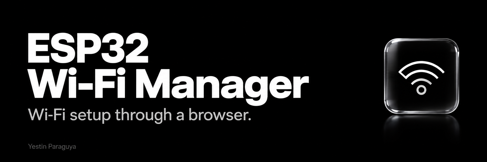
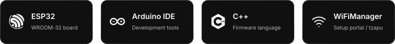
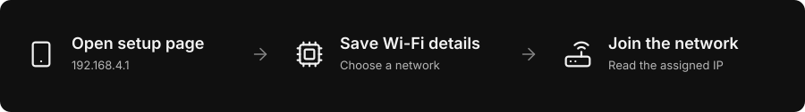
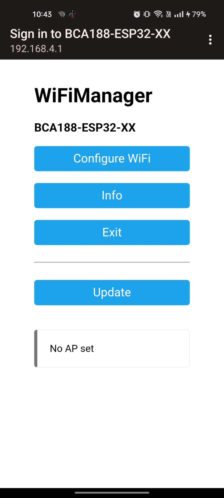
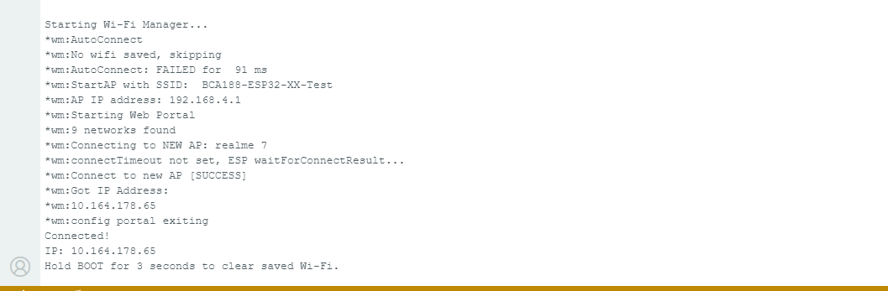
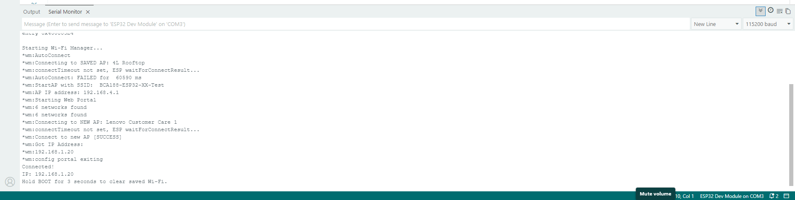
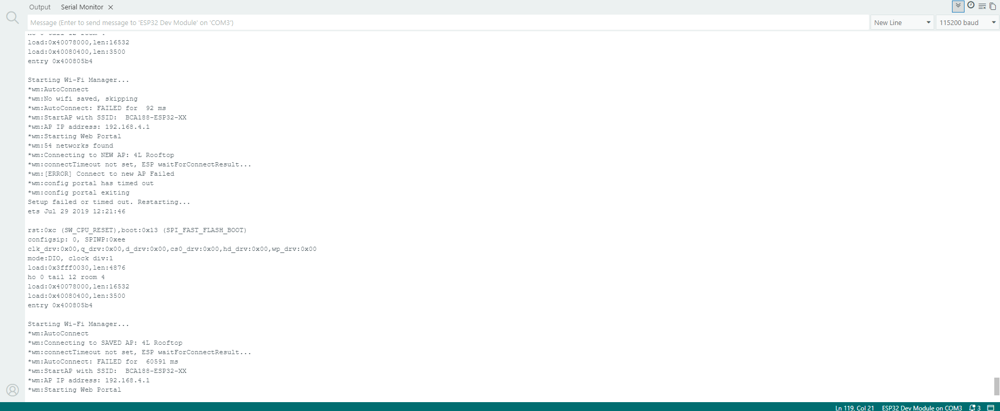
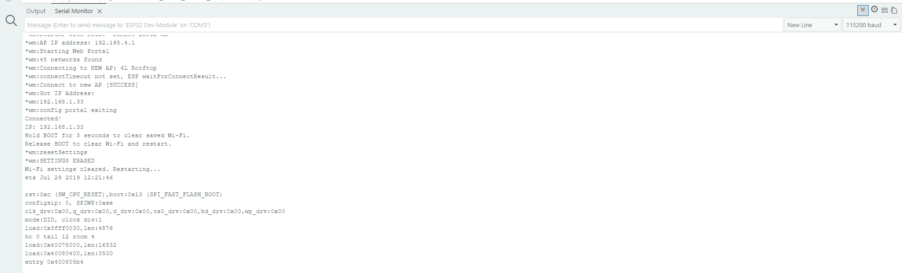
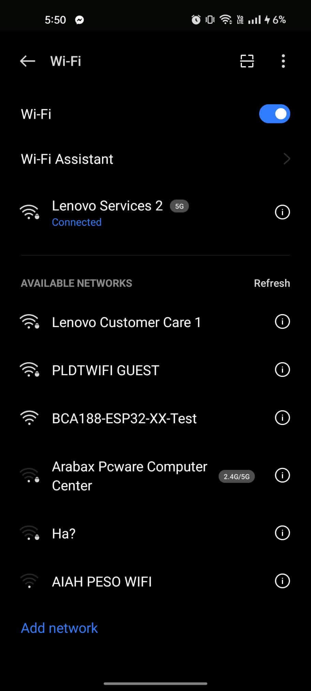

  

<picture>
  <source media="(max-width: 600px)" srcset="assets/technology/stack-mobile.svg">
  
</picture>

  <a href="#connection-flow">Connection flow</a> &nbsp; / &nbsp;
  <a href="#test-results">Test results</a> &nbsp; / &nbsp;
  <a href="#hardware-evidence">Hardware evidence</a> &nbsp; / &nbsp;
  <a href="#what-i-learned">What I learned</a>

I configured an ESP32 from my phone and used its setup page to switch
Wi-Fi networks without uploading new code. This repository records my
individual hardware tests using an ESP32-WROOM-32 development board.

**Name:** Yestin Paraguya &nbsp; · &nbsp; **Assigned number:** pending confirmation

[Open the Arduino sketch](firmware/Lab9_WiFiManager/Lab9_WiFiManager.ino)

<h2>
  <picture>
    <source media="(prefers-color-scheme: dark)" srcset="assets/sections/connection-flow-dark.svg">
    
  </picture>
</h2>

<picture>
  <source media="(max-width: 600px)" srcset="assets/connection-flow-mobile.svg">
  
</picture>

The ESP32 first tries its saved connection. If it cannot connect, it opens
its own setup network. I join that network and open `http://192.168.4.1`
to choose another Wi-Fi network. After connecting, the board prints its
assigned IP address in Serial Monitor at **115200 baud**.

<h2>
  <picture>
    <source media="(prefers-color-scheme: dark)" srcset="assets/sections/test-results-dark.svg">
    
  </picture>
</h2>

| Test | What I observed |
| :--- | :--- |
| Wrong password | The connection failed. The setup portal timed out and the board restarted. It then failed to reconnect with the saved details and reopened its setup network. |
| Reset settings | I held BOOT for three seconds, then released it when prompted. The board erased its saved Wi-Fi settings, restarted, and reopened the setup network. |
| Change the name | After changing `AP_NAME` and uploading, `BCA188-ESP32-XX-Test` appeared in my phone's Wi-Fi list. |
| Different network / phone hotspot | I selected my realme 7 phone hotspot, `realme 7`, through the setup page. The ESP32 connected successfully and received `10.164.178.65`, without changing or uploading the code again. |

The first successful connection was to `4L Rooftop` at `192.168.1.33`.
I also connected to `Lenovo Customer Care 1` at `192.168.1.20`, then
confirmed the phone-hotspot test with `realme 7` at `10.164.178.65`.
`XX` is a temporary placeholder for my assigned number.

<h2>
  <picture>
    <source media="(prefers-color-scheme: dark)" srcset="assets/sections/hardware-evidence-dark.svg">
    
  </picture>
</h2>

### Setup page on my phone

I opened the ESP32's setup page at `192.168.4.1`.

  

### Successful phone-hotspot connection

The ESP32 joined my realme 7 phone hotspot, named `realme 7`, and received
`10.164.178.65`. Serial Monitor shows `Connect to new AP [SUCCESS]`,
followed by `Connected!` and the assigned IP address.
This address comes from the hotspot; `192.168.4.1` is the setup page address.

  

Click a screenshot to view the original at full size.

Earlier connection to another Wi-Fi network

Before testing the phone hotspot, I connected to `Lenovo Customer Care 1`.
The ESP32 received `192.168.1.20`.

Wrong password, timeout, and automatic restart

The log shows `Connect to new AP Failed`, `config portal has timed out`,
and `Setup failed or timed out. Restarting...`. After restarting, the board
tries the saved network and opens the setup portal again.

BOOT button clears saved settings

After a three-second hold and release, Serial Monitor reports
`SETTINGS ERASED` and `Wi-Fi settings cleared. Restarting...`.

Changed setup network name

My phone lists `BCA188-ESP32-XX-Test` after I change the setup network name
and upload the sketch.

  

<h2>
  <picture>
    <source media="(prefers-color-scheme: dark)" srcset="assets/sections/what-i-learned-dark.svg">
    
  </picture>
</h2>

WiFiManager saves the network details I enter through the setup page on
the ESP32, so I can connect to a different network without changing the code.

In my sketch, the setup portal has a **180-second timeout**. If
`autoConnect()` returns failure, the sketch waits three seconds and calls
`ESP.restart()`. The BOOT reset is checked after Wi-Fi setup finishes;
I hold the button for three seconds and release it before the board clears
its settings and restarts.

---

[Yestin Paraguya](https://github.com/xavieryyyyyy) · Individual project

Built with [WiFiManager by tzapu](https://github.com/tzapu/WiFiManager).
Icons by [Lucide](https://lucide.dev/) ([ISC license](assets/icons/LICENSE)).
Technology logos by [Simple Icons](https://simpleicons.org/)
([CC0 license](assets/technology/LICENSE)). Custom graphics use
[Inter](https://rsms.me/inter/) ([OFL license](assets/technology/Inter-OFL.txt)).
The six screenshots are from my hardware tests.
